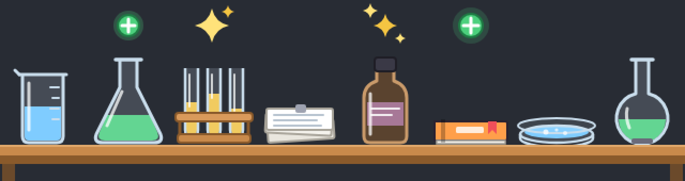
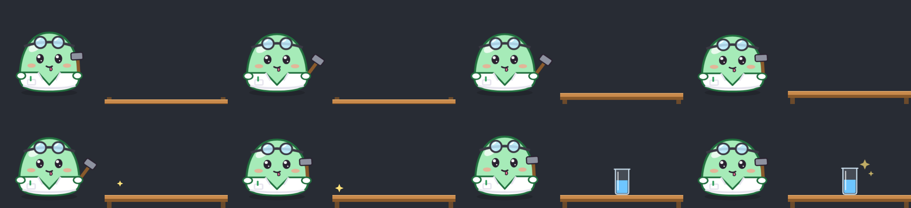

# savvy-lab

Claude Code plugins for orchestrated subagent work, with a lab of animated blobs that shows what each agent does.

> **Fork notice.** `savvy-progress` here is a fork of [johnnyvizz/claude-kit](https://github.com/johnnyvizz/claude-kit) (savvy-progress 1.2.1, MIT). It was forked to add the lab blobs, the per-agent lab table of file work, the planned-task build loop and real terminal pictures. The original work is © johnnyvizz; see [LICENSE](LICENSE).

| Lab blobs | Lab table | Planned build loop |
| --- | --- | --- |
|  |  |  |

## Plugins

| Plugin | What it does |
| --- | --- |
| [`savvy-progress`](savvy-progress) | Progress bar above the prompt and an agents panel. Each subagent is a lab blob: its gear shows the tier, its colour is its own, and its lab table shows the files it writes, edits and deletes. |
| [`savvy-flow-autostart`](savvy-flow-autostart) | A `SessionStart` hook that loads the savvy-flow playbook into every session, so each task goes through plan → delegate → review without the slash command. |

## Themes

`savvy-progress` draws its terminal panel in three layers (agents, items, bench), each from a theme: the built-in `lab`, or a folder you add to `~/.claude/sprite-packs/`. Switch with `/agents-theme` while Claude Code runs; mix layers from different themes. Format in [savvy-progress/README.md](savvy-progress/README.md).

| Theme | How to get it |
|---|---|
| [Chattini](packs/chattini) | Raora Panthera's mascot (hololive EN). The recipe downloads her emotes on your machine and builds the pack; this repository ships no official art. Bench items are drawn for the pack: a café counter with pickles, gelato and espresso. |

## Install

1. Add the marketplace:
   ```
   claude plugin marketplace add ridzuan5757/savvy-lab
   ```
2. Install the panel:
   ```
   claude plugin install savvy-progress@local-plugins
   ```
3. Optional: install savvy-flow from upstream, and the autostart hook. For one project only, install the hook with `--scope local` from that project's folder.
   ```
   claude plugin marketplace add johnnyvizz/claude-kit
   claude plugin install savvy-flow@claude-kit
   claude plugin install savvy-flow-autostart@local-plugins
   ```
4. Restart Claude Code.

If you install the upstream `savvy-progress@claude-kit` too, uninstall it: both register the same tools.

## Requirements

- Terminal pictures need a terminal with the kitty graphics protocol and Unicode placeholders: Ghostty, kitty or a libghostty terminal. Other terminals get half-block pixel sprites.
- Bash file tracking needs the session to run inside a git repository; elsewhere only `rm` and `mv` in the command text are seen.
- `savvy-flow-autostart` needs `savvy-flow@claude-kit`.

## Rebuild the sprites

```
tools/render/render.sh
```

It needs Google Chrome and Python 3 with Pillow. See [tools/render](tools/render).

## License

MIT. See [LICENSE](LICENSE).
